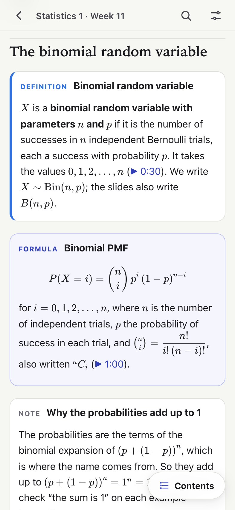

<h1 align="center">Revise</h1>

<b>Week-by-week revision for Statistics, Mathematics, English and Python, on your phone.</b> 
Every topic of every lecture, explained from the basics with every step written out. Labs to play with the ideas,
and every formula in one place. It works offline after the first visit.

<b>Open it: <a href="https://bhaskar0210s.github.io/revise/">bhaskar0210s.github.io/revise</a></b>

  
  
  

## What is inside

- **Seven courses**: Statistics 1 and 2, Mathematics 1 and 2, English 1 and 2, and Python. Each has a page for
  every week and an **All weeks** page that revises the whole course.
- **A week page** covers every lecture of that week: the idea from the basics, definitions, formulas with every
  symbol explained, the lecture's own worked examples with each step, common mistakes, tricks to remember, and
  "check yourself" questions with full answers. Each lecture is linked at the minute where a topic starts.
- **Labs**: coins and dice for probability and statistics; sets, functions and calculus, graph algorithms, matrices
  and vectors, and functions of two variables for mathematics. Change any value and every step is worked out again.
  Week pages open a lab on the right topic with the right numbers.
- **Formulas**: every formula of every week, searchable, each linked back to where it is explained.
- **Made for the phone**: light and dark mode, adjustable text size, a contents sheet on long pages, and "mark as
  revised" to keep track of your weeks.

  

## Put it on your iPhone

1. Open [bhaskar0210s.github.io/revise](https://bhaskar0210s.github.io/revise/) in Safari.
2. Tap the Share button, then **Add to Home Screen**.

It opens full screen, like an app, and works without a network after the first visit.

## Private by design

- No accounts, no cookies, no analytics, no ads. The site loads nothing from other servers.
- Your "revised" marks and settings stay in your browser.
- Free and open source under the MIT License.

## How it is made

The pages are written in Markdown with LaTeX and typeset with KaTeX when the site is built, so a phone only has to
show finished HTML. The labs are plain JavaScript with exact fractions. There is no framework and no tracking; the
whole site is a set of static files.

  

