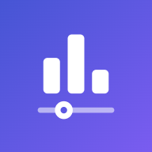
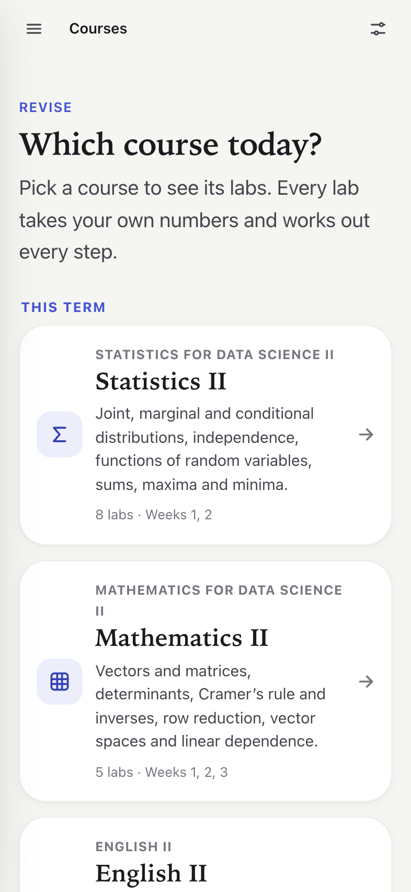
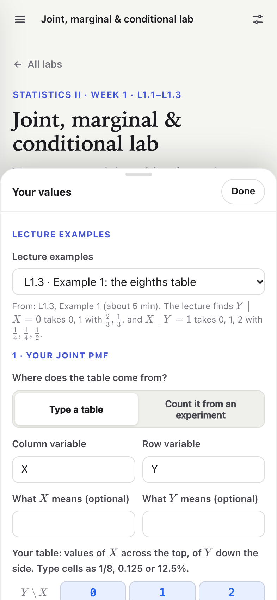
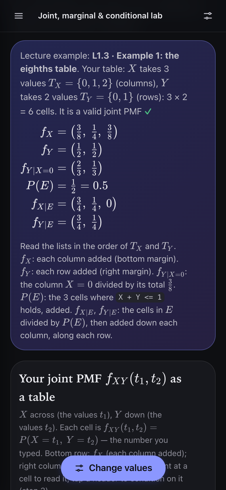
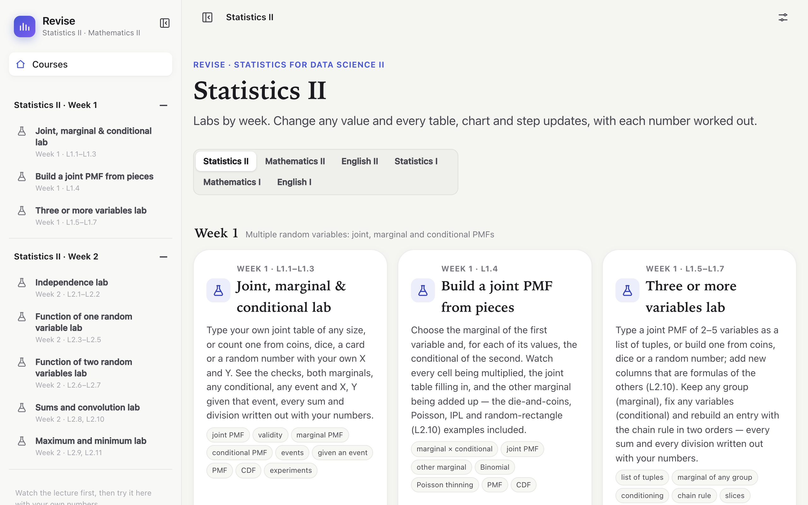
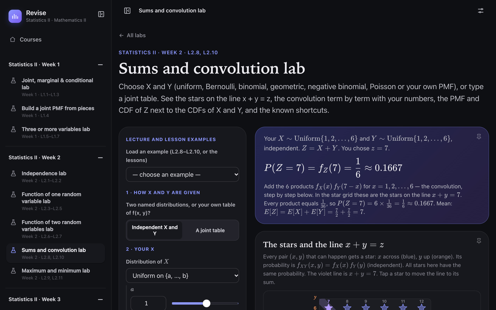

<p align="center"></p>

<h1 align="center">Revise</h1>

<p align="center"><b>Revision labs for Statistics, Mathematics and English that fit in your pocket.</b><br>
In the maths and statistics labs every number is yours and every step is worked out; the English labs hold each lecture’s rules, examples and tricks, with a quick check.<br>
About 1220 KB in all. It works offline after the first visit, on a phone or a computer.</p>

<p align="center">
  
  
  
</p>

<p align="center"><b>Open it: <a href="https://bhaskar0210s.github.io/revise/">bhaskar0210s.github.io/revise</a></b></p>

## What it does

- **Pick your course first.** Statistics I and II, Mathematics I and II, English I and II. The site remembers
  your choice, and the sidebar shows only that course's weeks.
- **Every value is yours.** Change a table cell, a probability, a distribution or a matrix entry, and every
  table, chart and formula redraws at once.
- **No number without its origin.** Each sum, product and division is written out with your numbers, step by
  step, so you can see where every result comes from.
- **The lecture's examples are built in.** Load one with a tap, check it against the video, then change it.
  Lecture numbers (L1.3, L2.8, …) follow the course videos.
- **English, revision first.** Each lecture becomes one page: the points to remember, the rules with the
  lecture's own examples, tricks to remember them, and "Spot it": decide which rule a sentence shows, then read why.
- **Made for the phone.** On a small screen the values open in a sheet from the bottom, so the results stay in
  view while you change them. Light and dark mode follow your device; text size and page width are in Settings.

## The labs

**Statistics I**

| Week | Labs |
|---|---|
| 1 | Data types and scales |
| 2 | Categorical data and charts |
| 3 | Describe a dataset · Frequency tables and histogram |
| 4 | Two categorical variables · Scatter, covariance and correlation |
| 5 | Counting · Arrangements |
| 6 | Combinations in practice |
| 7 | Events and Venn |
| 8 | Conditional probability and Bayes |
| 9 | Random variable, PMF and CDF |
| 10 | Expectation and variance |
| 11 | Binomial, hypergeometric and Poisson |
| 12 | Continuous distributions and the normal |

**Statistics II**

| Week | Labs |
|---|---|
| 1 | Joint, marginal & conditional (L1.1–L1.3) · Build a joint PMF from pieces (L1.4) · Three or more variables (L1.5–L1.7) |
| 2 | Independence (L2.1–L2.2) · Function of one random variable (L2.3–L2.5) · Function of two random variables (L2.6–L2.7) · Sums and convolution (L2.8, L2.10) · Maximum and minimum (L2.9, L2.11) |

**Mathematics II**

| Week | Labs |
|---|---|
| 1 | Matrix · Vectors and vector spaces (L1.1, L3.1–L3.2) · Row reduction |
| 2 | Cramer's rule and inverse |
| 3 | Linear dependence |

<p align="center">
  
</p>

## Put it on your iPhone

1. Open [bhaskar0210s.github.io/revise](https://bhaskar0210s.github.io/revise/) in Safari.
2. Tap the Share button, then **Add to Home Screen**.

It opens full screen, like an app. After the first visit it works without a network, so you can revise
anywhere. When the site changes, your phone fetches the new version once, on the next visit.

## Private by design

- No accounts, no cookies, no analytics, no ads. The site loads nothing from other servers.
- The values you type stay in your browser (local storage), so each lab opens the way you left it.
- Free and open source under the MIT License.

## Run it yourself

There is no build step: the site is plain HTML, CSS and JavaScript.

```sh
git clone https://github.com/bhaskar0210s/revise.git
open revise/index.html
```

`index.html` works straight from the disk. The offline cache runs only over https or on `localhost`; to try it,
serve the folder (`python3 -m http.server`) and open `http://localhost:8000`.

## How it stays small

- **No framework, no build tools.** The labs and the code they share are written by hand: about 810 KB
  of JavaScript and CSS over the network.
- **One library.** KaTeX typesets the maths (330 KB with its fonts); see `THIRD-PARTY-NOTICES`.
- **System fonts.** Text uses the fonts already on your device, so none are downloaded.
- **One download.** The first visit stores every file (1220 KB, measured with gzip, as GitHub Pages serves
  it). After that, opening a lab needs no network at all.

<p align="center">
  
</p>
